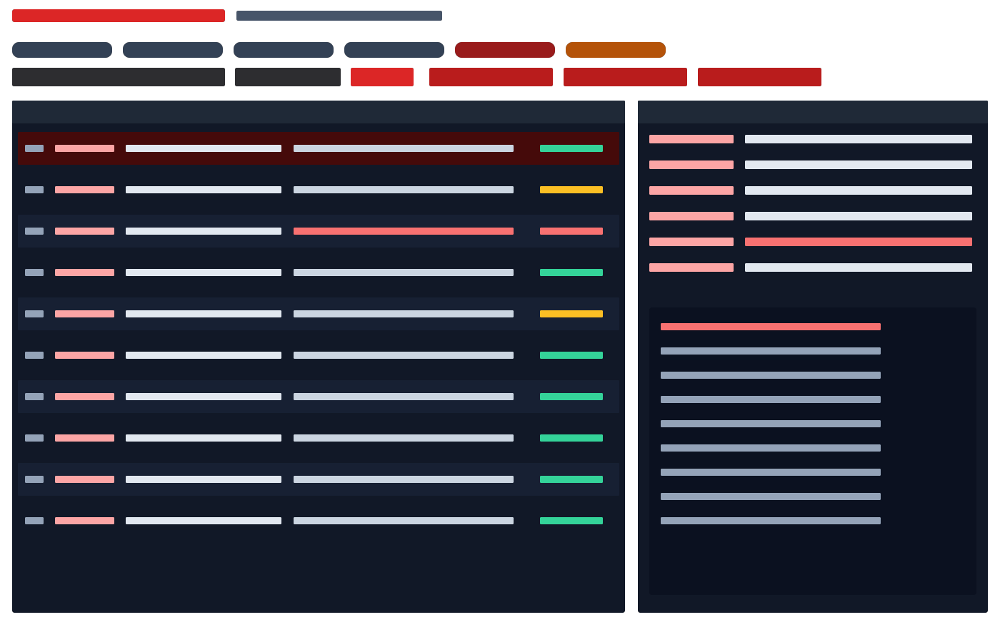

# Ansible Playbook Viewer for VS Code

Inspect `playbook.yml`, `playbook.yaml`, `site.yml`, `*.playbook.yml`, `inventory.ini` and `hosts.ini` files right in VS Code without installing Python or `ansible-lint`. Production automation repositories grow across plays, roles, tasks, handlers, host groups and vault variables where a `shell` task missing `changed_when`, a global `become: true` flag, an `ignore_errors: true` bypass or a plaintext password is easy to miss. This extension parses playbooks and INI inventories locally in plain JavaScript with zero Python runtime and zero cloud calls.

## What it opens

- `playbook.yml`, `playbook.yaml`, `site.yml`, `*.playbook.yml`, `inventory.ini` and `hosts.ini` files.
- Any open playbook YAML or inventory INI file via the Command Palette or Explorer context menu (Open in Ansible Playbook Viewer).
- Nothing to install, no Python or `ansible-lint` runtime required, nothing uploaded.

## The free part

- Play, role, task and handler explorer: lists every play, role, task, handler or inventory host with target host group, module name, tags, `become` flag and status.
- Target host and tag filter: search across hosts, tags, plays, tasks and modules, or filter by `become: true`, roles, handlers or findings.
- Variable and vault reference table: extracts every `{{ variable }}`, play `vars`, inventory group variable and `$ANSIBLE_VAULT` marker with line numbers.
- Static idempotency and security findings: flags `shell`/`command` tasks without `changed_when`, play-level `become: true` global root escalation, `ignore_errors: true`, `state: latest` packages and plaintext passwords or tokens.

## The Pro tools, with 1 free try

Pro adds the audit, diff and export steps: generate a Markdown idempotency and security audit for a playbook or folder, compare two Ansible playbooks or INI inventories in Markdown, or export a Markdown task and role runbook plus a CSV inventory locally. Your first try of each Pro tool is free. Zovo Pro is USD 19 once, and the team licence is USD 59.

## Why not plain text

Reading a 400-line playbook as raw YAML makes it easy to miss that one `ansible.builtin.shell` task lacks `changed_when`, that `become: true` applies to the entire play, or that a plaintext database password sits inside `vars:`. A local viewer puts plays, tasks, variables and findings on one screen.

## More tools by Zovo

See full docs and install options at [vscode.zovo.one/extensions/zovo-ansible-playbook-viewer/](https://vscode.zovo.one/extensions/zovo-ansible-playbook-viewer/), browse all Zovo VS Code extensions at [vscode.zovo.one](https://vscode.zovo.one/), or explore [Zovo Pro](https://vscode.zovo.one/pro/).
